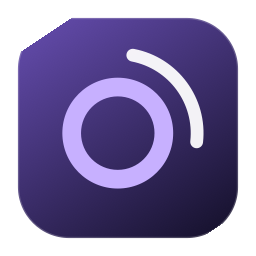
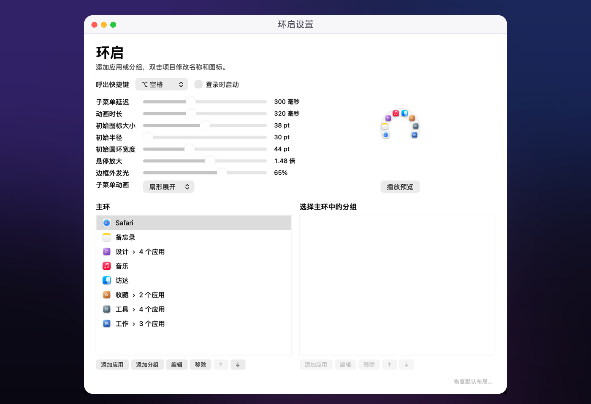

<p align="center">
  
</p>

<h1 align="center">环启 · Orbital</h1>

<p align="center">
  <strong>用一个圆环启动常用应用。</strong><br>
  macOS 菜单栏启动器，支持自定义分组、外圈子菜单和两层键盘导航。
</p>

<p align="center">
  
  
  
</p>

<p align="center">
  <a href="#快速开始">快速开始</a> ·
  <a href="#界面一览">界面一览</a> ·
  <a href="#键盘操作">键盘操作</a> ·
  <a href="#设置">设置</a> ·
  <a href="#开发与分发">开发与分发</a>
</p>

<p align="center">
  <a href="Docs/images/main.png"></a><br>
  <sub>按 <kbd>⌥</kbd> + <kbd>Space</kbd> 呼出主环，点击图标启动应用。</sub>
</p>

## 快速开始

需要 **macOS 14 或更新版本**，以及 Apple 命令行开发工具或 Xcode。已下载源码的话，直接在项目目录执行最后两行。

```sh
git clone https://github.com/icepual/orbital.git
cd orbital
./build.sh
open "./环启.app"
```

启动后，按 **⌥ 空格** 呼出或收起圆环。也可以点菜单栏的环形图标，选择「呼出圆环」。默认快捷键冲突时，菜单栏会显示实际启用的组合。

| 想做什么 | 怎么做 |
| --- | --- |
| 启动常用应用 | 点击主环图标。悬停时图标放大并显示名称。 |
| 查看分组 | 悬停在分组上片刻，或点击分组，应用会沿外圈展开。 |
| 搜索应用 | 呼出圆环后直接打字，支持名称、拼音和首字母。 |
| 浏览全部应用 | 按 <kbd>Tab</kbd>，打开 macOS 的系统应用浏览器。 |
| 查看或退出运行中的应用 | 图标朝圆心的一侧会显示运行圆点。右键菜单按状态提供「打开」或「退出」。 |

## 界面一览

| 外圈子菜单 | 设置与实时预览 |
| :---: | :---: |
| [](Docs/images/submenu.png) | [](Docs/images/settings.png) |
| 子菜单沿主环外侧展开，父分组保持放大。 | 拖动滑块看效果，或在下方编辑主环与分组。 |

<details>
<summary><strong>播放子菜单展开动图</strong></summary>

<p align="center">
  
</p>

</details>

## 键盘操作

用方向键选中主环上的分组，外圈会**立即预览**，焦点还在主环。按一次**回车**进入分组并选中第一项。接下来方向键只在组内移动，再按回车打开选中的应用。

| 快捷键 | 操作 |
| --- | --- |
| <kbd>⌥</kbd> + <kbd>Space</kbd> | 呼出或收起圆环，可在设置中更换 |
| <kbd>←</kbd> / <kbd>↑</kbd> · <kbd>→</kbd> / <kbd>↓</kbd> | 在当前层选上一项或下一项 |
| <kbd>Return</kbd> | 进入分组或打开选中的应用 |
| <kbd>Esc</kbd> | 从子菜单回到父分组并保留预览，再按收起预览，继续按可关闭圆环 |
| <kbd>Tab</kbd> | 打开 macOS 的系统应用浏览器 |
| <kbd>⌘</kbd> + <kbd>,</kbd> | 在圆环打开时进入设置 |

## 设置

从菜单栏选择「设置…」，修改会自动保存在本机。

- **布局**：主环最多放 16 项，每个分组最多放 18 个应用。可添加、移除和排序，双击项目可编辑名称、图标或目标应用。
- **分组图标**：从 12 款内置图标中挑选，或导入自己的图片。
- **外观**：可调初始图标大小、半径、环带宽度、放大倍数和外发光。半径会根据项目数量留出空间。
- **动画**：可调子菜单延迟和动画时长。内置**扇形展开、外侧滑入、逐个淡入、轻盈回弹**，可在设置里播放预览。
- **启动**：可开启「登录时启动」。环启常驻菜单栏，隐藏 Dock 图标。

环启为应用名称和运行状态提供 VoiceOver 标签，并遵循系统的「减少动态效果」设置。

<details>
<summary><strong>常见问题</strong></summary>

**快捷键没反应？** 在菜单栏查看当前实际启用的快捷键，或到设置里更换组合。

**如何用触摸板手势呼出？** 可以在支持自定义手势的工具中，把手势映射到环启的呼出快捷键。

**恢复默认布局会重置什么？** 主环和分组会恢复默认，快捷键与外观设置会保留。

</details>

## 开发与分发

项目使用 **Swift + AppKit**，没有第三方依赖。`./build.sh` 按本机架构编译，在项目目录生成临时签名的 `环启.app`。重新构建前请先退出正在运行的环启。

```sh
./test.sh
```

回归检查覆盖环形几何、布局、动画、命中区域和预览缩放。

<details>
<summary><strong>源码导览</strong></summary>

| 位置 | 用途 |
| --- | --- |
| [Launcher.swift](Sources/Launcher.swift) | 应用入口、菜单栏、全局快捷键与应用启动 |
| [SettingsWindow.swift](Sources/SettingsWindow.swift) | 设置窗口、分组编辑与实时预览 |
| [CatalogView.swift](Sources/CatalogView.swift) · [Models.swift](Sources/Models.swift) | 快速搜索、应用索引及本地配置 |
| [GroupIcons.swift](Sources/GroupIcons.swift) | 内置分组图标 |
| [Sources/Ring/](Sources/Ring/) | 圆环布局、动画、绘制、键盘和鼠标交互、无障碍 |
| [Tests/RingCoreChecks.swift](Tests/RingCoreChecks.swift) | 核心逻辑的回归检查 |

圆环的绘制、命中测试和无障碍元素共用同一份布局。配置以 JSON 保存到 `UserDefaults` 的 `launcherConfiguration` 键。

</details>

> [!NOTE]
> 本地构建使用临时签名。对外分发时，需要另行使用 Developer ID 签名并完成 Apple 公证；也可以分享源码，让对方在自己的 Mac 上构建。
