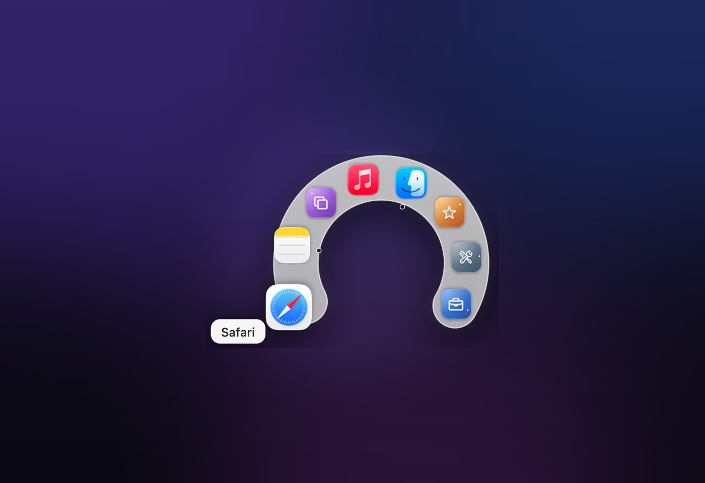
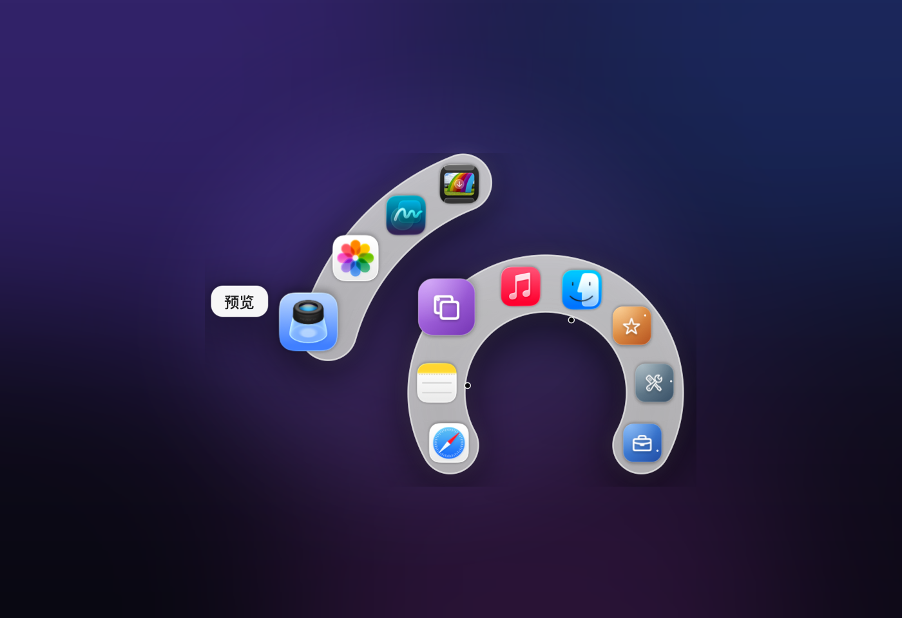
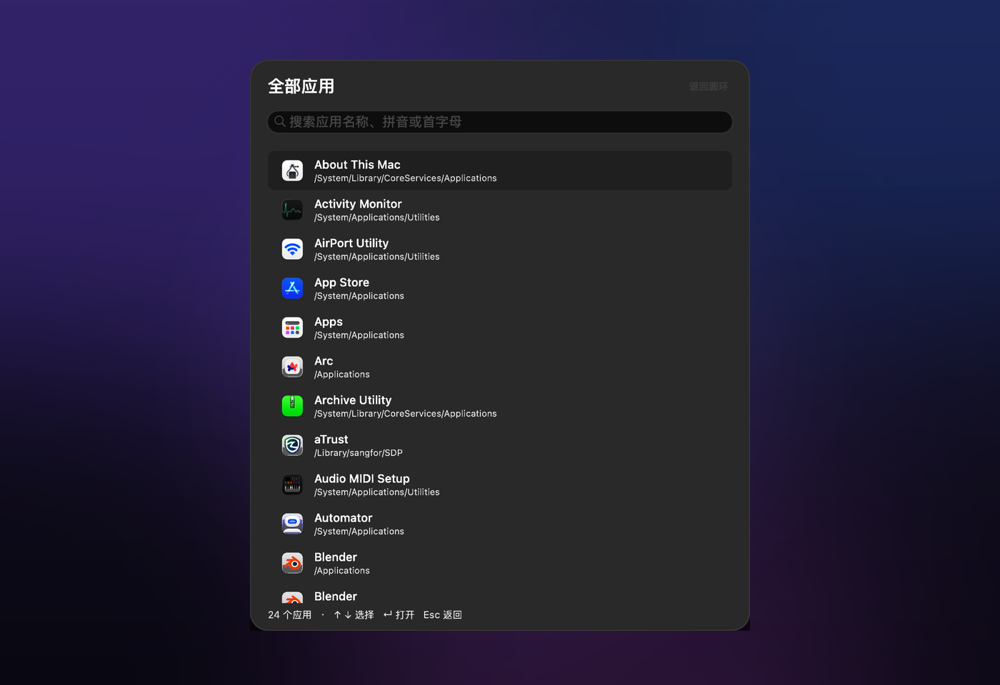

# 环启 · Orbital

<p align="center">
  
</p>

环启是一款原生 macOS 环形启动器。它常驻菜单栏，按一个快捷键就能把常用 App、分组和搜索收进一个圆环里；没有 Dock 图标，没有第三方依赖，启动和呼出都很轻。

最低系统版本为 **macOS 14**。当前构建以本机使用为主，采用临时签名；分享给他人前请先阅读文末的[分发说明](#分发说明)。

## 功能

### 一个圆环，随手呼出

- 默认按 `⌥ 空格` 呼出/收起；菜单栏的环形图标也可以打开。
- 快捷键冲突时，环启会自动尝试备用组合，菜单栏会显示当前实际可用的快捷键。
- 主环最多放 **16 项**；每个分组最多放 **18 个应用**。
- 圆环半径按项目数量自动调整，图标多时环会自动变大。

### 悬停放大与分组子菜单

- 鼠标移到图标上会放大图标并显示名称，相邻图标按距离依次放大。
- 悬停在分组上约 0.3 秒后展开外圈子菜单；离开分组和子菜单后自动收起。
- 子菜单支持四种展开样式：**扇形展开、外侧滑入、逐个淡入、轻盈回弹**，可以在设置中切换，也可以播放预览。
- 点击主环上的应用直接启动；点击分组展开；移开分组、点击圆环外或按 `Esc` 收起。



<p align="center">
  
</p>
<p align="center"><sub>GIF 为循环演示，实际动画约 0.32 秒</sub></p>

### 全部应用与快速搜索

- 按 `Tab`，或从菜单栏选择「全部应用」，打开 macOS 原生应用浏览器（旧版系统为 Launchpad）。
- 在圆环打开时直接输入文字，会打开环启自己的应用列表，支持按**名称、拼音、首字母**匹配。
- 应用列表会读取系统应用目录、个人 Applications 目录，以及手动选进圆环的应用。
- 正在运行的应用会在图标旁显示一个小圆点；右键图标可以「打开」或「退出」。



### 键盘与鼠标

| 操作 | 快捷键 |
|---|---|
| 呼出/收起圆环 | `⌥ 空格`（可在设置中更换） |
| 打开全部应用 | `Tab` 或菜单栏「全部应用」 |
| 快速搜索 | 圆环打开时直接输入 |
| 在圆环中移动选择 | 方向键 |
| 打开当前项 | `Return` |
| 返回/收起 | `Esc` |
| 打开设置 | 圆环打开时按 `⌘,` 或从菜单栏进入 |
| 打开/退出应用 | 右键应用图标 |

### 设置与外观

设置窗口支持：

- 添加/移除/排序主环项目和分组应用，双击编辑名称、图标或目标应用；
- 调整子菜单延迟、动画时长、初始图标大小、初始半径、圆环宽度、悬停放大、边框外发光；
- 选择子菜单动画并实时预览；
- 恢复默认布局；
- 开启「登录时启动」。

所有设置保存在本机 `UserDefaults` 中，不需要额外配置文件。


### 菜单栏常驻与登录启动

- 环启是菜单栏应用（`LSUIElement`），不占用 Dock 图标。
- 可通过「登录时启动」让它随系统登录自动运行。
- 设置、全部应用、呼出圆环和退出都可以从菜单栏进入。

### 无障碍与轻量

- 支持 VoiceOver：主环、分组子菜单、应用名称和「运行中」状态都有无障碍标签。
- 遵循系统的「减少动态效果」设置，关闭不必要的放大与过渡动画。
- 使用 macOS 自带框架（AppKit、CoreGraphics、Carbon），没有第三方依赖，也不需要网络。

## 构建

需要 Apple 命令行开发工具或 Xcode：

```sh
./build.sh
```

脚本会以当前 Mac 的架构编译，在项目目录生成经临时签名的「环启.app」。重新构建前请先退出正在运行的环启。

> 当前 `build.sh` 只构建当前架构（Apple Silicon 机器上为 arm64），不会自动生成 universal binary。

环形几何、布局、动画状态机和命中测试的回归检查可以运行：

```sh
./test.sh
```

它不需要额外依赖，也不会生成 app。

## 项目结构

```text
Sources/
  Launcher.swift          App 生命周期、菜单栏、热键、面板、打开应用
  CatalogView.swift       全部应用列表与搜索
  SettingsWindow.swift    设置窗口与实时预览
  Models.swift            配置、应用目标、应用索引和搜索评分
  GroupIcons.swift        程序化生成的分组图标
  Ring/
    RingGeometry.swift    纯几何：半径、角度、抬升、弧线路径
    RingLayout.swift      每帧布局快照与子菜单弧线
    RingAnimation.swift   子菜单弧线、悬停放大和开场动画状态机
    RingHitTester.swift   点击/悬停命中测试
    RingRenderer.swift    玻璃背景、图标、提示标签绘制
    RingAccessibility.swift 无障碍元素构建
    RingView.swift        NSView 外壳、输入与计时器
Tests/
  RingCoreChecks.swift    纯核心回归检查
```

渲染、命中测试和无障碍共用同一份 `RingLayout` 快照；几何与动画状态机不依赖 `NSView`，可以直接在测试中推进。

## 配置

- 配置文件保存在 `UserDefaults` 的 `launcherConfiguration` 键中，内容是 JSON。
- 设置窗口中的修改会自动保存。
- 「恢复默认布局」只重置主环与分组；快捷键、外观等设置会保留。

## 分发说明

当前 `build.sh` 使用 ad-hoc 临时签名：

```sh
codesign --force --sign - 环启.app
```

这在构建它的 Mac 上可以运行，但**不适合直接分享给他人**。别人从网上下载后，macOS Gatekeeper 会提示无法验证开发者或已损坏；较新的系统需要到「系统设置 → 隐私与安全性」手动允许。

正式分享需要：

1. Apple Developer Program 账号；
2. 使用 **Developer ID Application** 证书签名；
3. 开启 hardened runtime，并提交 Apple 公证；
4. 将 App 打包成 `.dmg`，对 DMG 签名并公证后 `stapler staple`。

如果没有 Developer ID，比较稳妥的方式是分享源码，让对方运行 `./build.sh` 本机构建。

## 常见问题

### 能用触摸板五指捏合打开吗？

不能由环启原生实现。五指捏合属于系统 Launchpad/Apps 手势，macOS 没有向第三方 App 开放全局手势重映射接口。可以借助 BetterTouchTool、Swish 等工具把手势映射到 `⌥ 空格`，或直接映射到「打开环启」。

### 快捷键冲突怎么办？

环启会尝试备用快捷键，菜单栏会显示实际可用的组合；也可以在设置的「呼出快捷键」中更换。

### 全部应用为什么打开的是系统界面？

`Tab`/菜单栏的「全部应用」调用 macOS 原生 Launchpad/Apps；环启自己的应用列表由「在圆环中直接输入」打开。两者用途不同：前者是系统应用浏览器，后者是环启的快速搜索。

### 如何完全替代 Launchpad？

把 `Tab` 和菜单栏「全部应用」改为打开环启内部的应用列表即可，但这需要修改 `Launcher` 的入口逻辑。当前版本保留了系统启动器作为兜底。

## 开发

- 语言/框架：Swift + AppKit，最低 macOS 14。
- 入口：`Sources/Launcher.swift` 的 `@main`。
- 热键：Carbon `RegisterEventHotKey`。
- 视觉：`NSVisualEffectView` + CoreGraphics 自绘。
- 测试：`./test.sh`。
