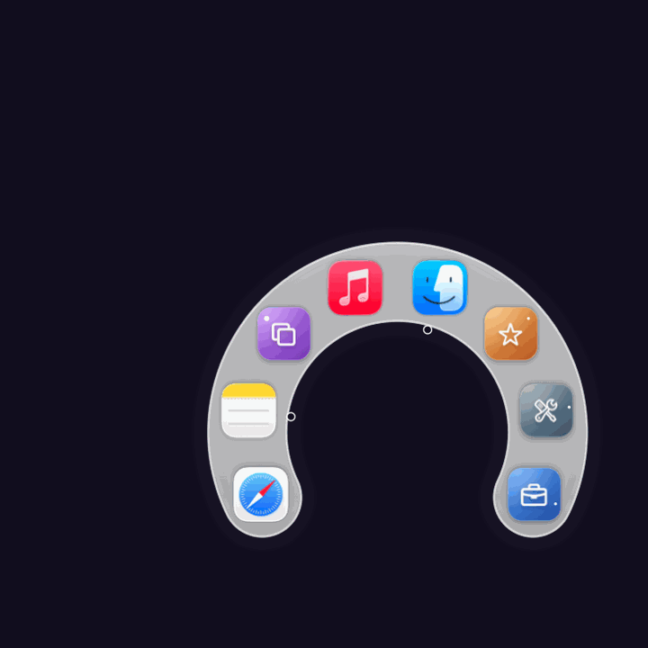

<p align="center">
  
</p>

<h1 align="center">环启 · Orbital</h1>

<p align="center">
  <strong>把常用 App，收进一个圆环。</strong><br>
  原生 macOS 环形启动器 · 菜单栏常驻 · 零第三方依赖
</p>

<p align="center">
  
  
  
</p>

<p align="center">
  <a href="#功能">功能</a> ·
  <a href="#界面">界面</a> ·
  <a href="#快捷键">快捷键</a> ·
  <a href="#构建">构建</a> ·
  <a href="#分发说明">分发</a> ·
  <a href="#常见问题">常见问题</a>
</p>

<p align="center">
  <a href="Docs/images/main.png">
    
  </a>
</p>
<p align="center"><sub><kbd>⌥</kbd> + <kbd>Space</kbd> 呼出 · 悬停放大 · 分组展开外圈</sub></p>

---

## 功能

### 呼出与环形主菜单

- 默认按 `⌥ 空格` 呼出/收起，菜单栏的环形图标也可以打开。
- 快捷键冲突时自动尝试备用组合，菜单栏会显示当前实际可用的快捷键。
- 主环最多放 **16 项**，每个分组最多放 **18 个应用**。
- 圆环半径按项目数量自动调整，图标多时环会自动变大。

### 悬停与分组子菜单

- 鼠标移到图标上会放大图标并显示名称，相邻图标按距离依次放大。
- 悬停在分组上约 0.3 秒后展开外圈子菜单；离开分组和子菜单后自动收起。
- 四种子菜单展开样式：**扇形展开、外侧滑入、逐个淡入、轻盈回弹**，支持设置中切换和实时预览。
- 点击应用直接启动；点击分组展开；移开分组、点击圆环外或按 `Esc` 收起。

### 全部应用与快速搜索

- 按 `Tab`，或从菜单栏选择「全部应用」，打开 macOS 原生应用浏览器（旧版系统为 Launchpad）。
- 在圆环打开时直接输入文字，会打开环启自己的快速搜索列表，支持**名称、拼音、首字母**匹配。
- 应用列表会读取系统应用目录、个人 Applications 目录，以及手动选进圆环的应用。
- 正在运行的应用会在图标旁显示一个小圆点；右键图标可以「打开」或「退出」。

### 外观与设置

- 添加、移除、排序主环项目和分组应用；双击编辑名称、图标或目标应用。
- 调整子菜单延迟、动画时长、初始图标大小、初始半径、圆环宽度、悬停放大和边框外发光。
- 选择子菜单动画并实时预览，或一键恢复默认布局。
- 所有设置保存在本机 `UserDefaults`，不需要额外配置文件。

### 菜单栏、登录与无障碍

- 菜单栏常驻（`LSUIElement`），不占用 Dock 图标。
- 可开启「登录时启动」，随系统登录自动运行。
- 支持 VoiceOver：主环、分组子菜单、应用名称和「运行中」状态都有无障碍标签。
- 遵循系统「减少动态效果」设置，关闭不必要的放大与过渡动画。

---

## 界面

### 分组子菜单

<p align="center">
  <a href="Docs/images/submenu.png">
    
  </a>
</p>
<p align="center"><sub>悬停分组展开外圈；悬停应用显示名称并放大</sub></p>

### 子菜单动画

<p align="center">
  <a href="Docs/images/submenu.gif">
    
  </a>
</p>
<p align="center"><sub>GIF 为循环演示，实际动画约 0.32 秒</sub></p>

### 设置与实时预览

<p align="center">
  <a href="Docs/images/settings.png">
    
  </a>
</p>
<p align="center"><sub>主环/分组编辑、外观滑杆、动画选择和实时预览</sub></p>

---

## 快捷键

| 操作 | 快捷键 |
|---|---|
| 呼出 / 收起圆环 | <kbd>⌥</kbd> + <kbd>Space</kbd>（可在设置中更换） |
| 打开全部应用 | <kbd>Tab</kbd> 或菜单栏「全部应用」 |
| 快速搜索 | 圆环打开时直接输入 |
| 在圆环中移动选择 | <kbd>↑</kbd> <kbd>↓</kbd> <kbd>←</kbd> <kbd>→</kbd> |
| 打开当前项 | <kbd>Return</kbd> |
| 返回 / 收起 | <kbd>Esc</kbd> |
| 打开设置 | <kbd>⌘</kbd> + <kbd>,</kbd> |
| 打开 / 退出应用 | 右键应用图标 |

> [!NOTE]
> 「全部应用」打开的是 macOS 系统应用浏览器；环启自己的快速搜索列表由「在圆环中直接输入」打开。

---

## 构建

> [!NOTE]
> 需要 macOS 14+，以及 Apple 命令行开发工具（Command Line Tools）或 Xcode。

```sh
./build.sh
```

脚本会以当前 Mac 的架构编译，并在项目目录生成经临时签名的「环启.app」。重新构建前请先退出正在运行的环启。

当前 `build.sh` 只构建本机架构（Apple Silicon 上为 arm64），不会自动生成 universal binary。

### 测试

```sh
./test.sh
```

回归检查覆盖环形几何、布局、动画状态机、命中测试和预览缩放；不需要额外依赖，也不会生成 app。

---

## 项目结构

<details>
<summary>展开项目结构</summary>

<br>

```text
Sources/
  Launcher.swift          App 生命周期、菜单栏、热键、面板、打开应用
  CatalogView.swift       全部应用列表与搜索
  SettingsWindow.swift    设置窗口与实时预览
  Models.swift            配置、应用目标、应用索引和搜索评分
  GroupIcons.swift        程序化生成的分组图标
  Ring/
    RingGeometry.swift    纯几何：半径、角度、抬升、弧线路径
    RingLayout.swift      每帧布局快照与子菜单弧线
    RingAnimation.swift   子菜单弧线、悬停放大和开场动画状态机
    RingHitTester.swift   点击/悬停命中测试
    RingRenderer.swift    玻璃背景、图标、提示标签绘制
    RingAccessibility.swift 无障碍元素构建
    RingView.swift        NSView 外壳、输入与计时器
Tests/
  RingCoreChecks.swift    纯核心回归检查
```

渲染、命中测试和无障碍共用同一份 `RingLayout` 快照；几何与动画状态机不依赖 `NSView`，可以直接在测试中推进。

</details>

---

## 配置

| 项目 | 说明 |
|---|---|
| 配置存储 | `UserDefaults` 的 `launcherConfiguration` 键，JSON 格式 |
| 自动保存 | 设置窗口中的修改即时保存 |
| 恢复默认布局 | 只重置主环与分组；快捷键、外观等设置保留 |

---

## 分发说明

> [!WARNING]
> 当前 `build.sh` 使用 ad-hoc 临时签名，只适合在构建它的 Mac 上运行。直接分享给他人会被 Gatekeeper 拦截，提示无法验证开发者或已损坏；较新的 macOS 需要到「系统设置 → 隐私与安全性」手动允许。

正式分享需要：

1. Apple Developer Program 账号；
2. 使用 **Developer ID Application** 证书签名；
3. 开启 hardened runtime 并提交 Apple 公证；
4. 打包成 `.dmg`，对 DMG 签名、公证后 `stapler staple`。

如果暂时没有 Developer ID，比较稳妥的方式是分享源码，让对方在本地运行 `./build.sh`。

---

## 常见问题

<details>
<summary><strong>能用触摸板五指捏合打开吗？</strong></summary>

不能由环启原生实现。五指捏合属于系统 Launchpad/Apps 手势，macOS 没有向第三方 App 开放全局手势重映射接口。可以借助 BetterTouchTool、Swish 等工具把手势映射到 `⌥ 空格`，或直接映射到「打开环启」。

</details>

<details>
<summary><strong>快捷键冲突怎么办？</strong></summary>

环启会尝试备用快捷键，菜单栏会显示实际可用的组合；也可以在设置的「呼出快捷键」中更换。

</details>

<details>
<summary><strong>全部应用为什么打开的是系统界面？</strong></summary>

`Tab` / 菜单栏的「全部应用」调用 macOS 原生 Launchpad/Apps；环启自己的应用列表由「在圆环中直接输入」打开。两者用途不同：前者是系统应用浏览器，后者是环启的快速搜索。

</details>

<details>
<summary><strong>如何完全替代 Launchpad？</strong></summary>

把 `Tab` 和菜单栏「全部应用」改为打开环启内部的应用列表即可，但这需要修改 `Launcher` 的入口逻辑。当前版本保留系统启动器作为兜底。

</details>

---

## 开发

- 语言 / 框架：Swift + AppKit，最低 macOS 14。
- 入口：`Sources/Launcher.swift` 的 `@main`。
- 热键：Carbon `RegisterEventHotKey`。
- 视觉：`NSVisualEffectView` + CoreGraphics 自绘。
- 测试：`./test.sh`。

<p align="center"><sub>Made with Swift + AppKit · No third-party dependencies</sub></p>
